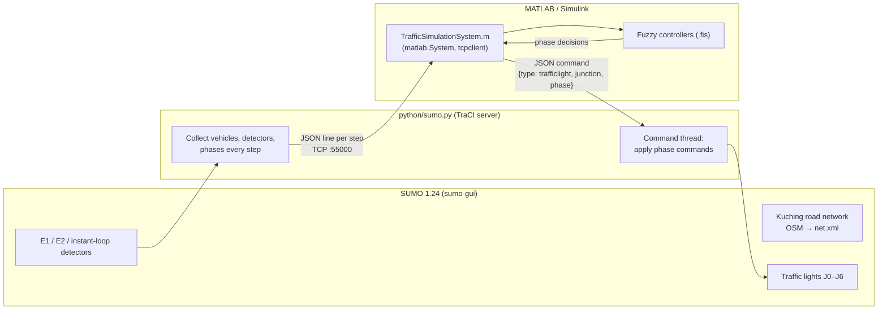
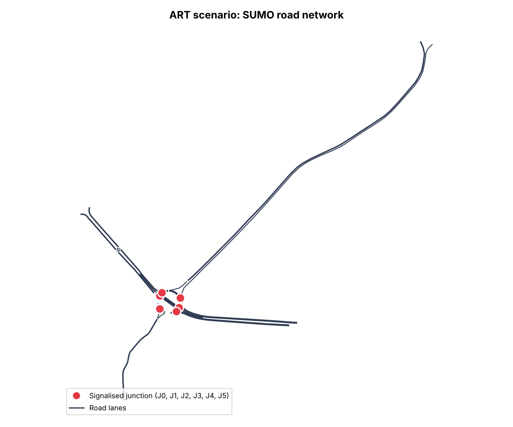
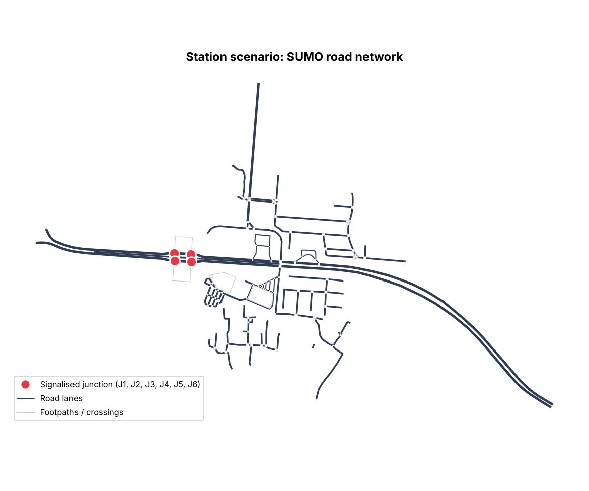

<div align="center">

# 🚦 SUMO ⇄ Simulink Fuzzy Traffic Control

### ENG20010 Engineering Technology Design Project · Swinburne University of Technology Sarawak

**Real Kuching road networks simulated in SUMO and controlled live by fuzzy-logic controllers in MATLAB/Simulink, linked over a TCP socket with TraCI.**


</div>

---

## 📌 Overview

| | |
|---|---|
| **Unit** | ENG20010 Engineering Technology Design Project |
| **Problem** | Fixed-time signals cannot react to queues, roundabout spill-back or pedestrians around Kuching's new ART (Autonomous Rapid Transit) corridor. |
| **Approach** | Simulate the real road layout in **SUMO**, stream live detector data to **Simulink**, let **fuzzy-logic controllers** decide signal phases, and send the decisions back into the running simulation. |
| **Scenarios** | **ART**: roundabout and through-road junctions on Jalan Tun Salahuddin · **Station**: ART station area at Darul Hana with signalised pedestrian crossings |
| **Link** | Python TraCI server ⇄ TCP `127.0.0.1:55000` ⇄ MATLAB `matlab.System` client inside Simulink |

## ✨ Features

- 🗺️ **Real maps:** both networks are built from OpenStreetMap extracts of Kuching and edited in SUMO netedit.
- 📡 **Live sensing:** induction loops (E1), lane-area detectors (E2) and instant loops for pedestrians feed Simulink every simulation step.
- 🧠 **Fuzzy decision making:** Mamdani controllers turn flow, occupancy and speed into phase durations and entry-control decisions.
- 🔁 **Closed loop:** Simulink sends JSON phase commands back, and the server applies them to the traffic lights with TraCI.
- 🚶 **Pedestrian safety (Station):** pedestrian green, emergency halt and crash-detection outputs for both sides of the crossing.
- ♻️ **Robust server:** the SUMO server reloads the scenario when Simulink disconnects, so you can rerun the model without restarting SUMO.

## 🏗️ System architecture



Each step the server sends one JSON line (Station scenario shown; ART has no `instant_loops`):

```json
{"time": 125.3, "step": 1253, "n_vehicles": 42,
 "vehicles": {"veh0": {"pos": [512.1, 88.4], "speed": 9.7, "lane": "..."}},
 "detectors": {"e1_0": true}, "instant_loops": {"e1i_0": 1},
 "area_detectors": {"e2_0": {"vehicle_count": 3, "mean_speed": 4.2}},
 "traffic_lights": {"J0": 2}}
```

and Simulink answers with commands such as `{"type": "trafficlight", "junction": "J0", "phase": 4}`.

## 🗺️ Scenarios

| ART scenario | Station scenario |
|:---:|:---:|
|  |  |
| Roundabout and through road on **Jalan Tun Salahuddin**, 6 signalised junctions (J0–J5), 13 lane-area detectors | ART station area at **Darul Hana**, 6 signalised junctions (J1–J6), 18 lane-area detectors, 8 instant loops for pedestrians |

### 🧠 Fuzzy controllers

| Controller | Scenario | Inputs | Outputs | Rules |
|---|---|---|---|---|
| `ComplexIntersectionFLC.fis` (**ComplexRoundaboutController**) | ART, Station | Entry flow rates (×4), roundabout flow, 50 m approach occupancy (×4), through-road car presence, exit flow, downstream exit occupancy (×4), roundabout occupancy | Phase durations for the straight-road and roundabout signals, roundabout entry control (×4) | 20 |
| `PedestrianController.fis` (**TrafficControlSystem**) | Station | Pedestrian presence left/right, occupancy start/middle, mean speed start/middle | Pedestrian green, emergency halt and car-crash detection, each for left and right | 14 |

Both are Mamdani systems and can be opened in MATLAB's **Fuzzy Logic Designer** (`fuzzyLogicDesigner('ART/ComplexIntersectionFLC.fis')`).

## 🚀 Getting started

### Requirements

- [SUMO 1.24](https://eclipse.dev/sumo/) with `SUMO_HOME` set, and `sumo-gui` on your `PATH`
- Python 3.9+ with the TraCI package: `pip install traci`
- MATLAB + Simulink with the **Fuzzy Logic Toolbox** and **Instrument Control** (`tcpclient`)

### Run a scenario

1. **Start the SUMO server** (pick `ART` or `Station`):

   ```bash
   cd ART
   python python/sumo.py --sumocfg map/main.sumocfg --steps 10000 --step-length 0.1 --port 55000
   ```

   `sumo-gui` opens and the server waits for MATLAB on `127.0.0.1:55000`.
2. *(Optional)* check the socket with `python python/server_test.py`.
3. **Open `Main.slx`** from the same scenario folder in MATLAB, make sure the `.fis` files are on the path, and press **Run**.
4. Watch the junctions in `sumo-gui` switch phases as the fuzzy controllers respond to the traffic. Stop Simulink and the server reloads the scenario, ready for the next run.

## 📁 Project structure

```
├── ART/                              # Roundabout + through-road scenario (Jalan Tun Salahuddin)
│   ├── Main.slx                      # Simulink model (client + fuzzy controller)
│   ├── TrafficSimulationSystem.m     # matlab.System: TCP client, parses detectors, sends commands
│   ├── ComplexIntersectionFLC.fis    # 15-input / 8-output Mamdani controller
│   ├── python/
│   │   ├── sumo.py                   # TraCI server: steps SUMO, streams JSON, applies phases
│   │   └── server_test.py            # Simple socket test client
│   └── map/
│       ├── map.osm                   # OpenStreetMap extract
│       ├── map.xml                   # SUMO network
│       ├── map.rou.xml               # Vehicle routes / flows
│       ├── map.add.xml               # E1 induction loops + E2 lane-area detectors
│       ├── map.ttl.xml               # Traffic-light programs
│       ├── main.sumocfg              # SUMO configuration
│       └── e1_*.xml, e2_*.xml        # Detector output from a sample run
├── Station/                          # ART station scenario (Darul Hana) with pedestrians
│   ├── Main.slx, TrafficSimulationSystem.m
│   ├── ComplexIntersectionFLC.fis
│   ├── PedestrianController.fis      # 6-input / 6-output pedestrian safety controller
│   ├── python/                       # Same server, plus instant loops for pedestrians
│   └── map/                          # Network, routes, person flows, detectors
└── docs/images/                      # Network renders used in this README
```

## 🔑 Key concepts

| Concept | Where it shows up |
|---|---|
| **Co-simulation** | SUMO runs the traffic; Simulink runs the controller; they exchange data each step. |
| **TraCI** | `traci.inductionloop`, `traci.lanearea`, `traci.trafficlight.setPhase` in `sumo.py`. |
| **Socket protocol** | Newline-delimited JSON from Python; JSON commands from MATLAB on a separate listener thread. |
| **MATLAB System objects** | `setupImpl`, `stepImpl`, `releaseImpl` manage the TCP connection inside Simulink. |
| **Fuzzy inference** | Membership functions + IF-THEN rules turn sensor readings into signal timing. |
| **Traffic engineering** | Approach occupancy, entry flow, downstream blocking and pedestrian demand drive phase choice. |

---

<div align="center">
<sub>Made by <b>Kean Fah Chai</b> · Swinburne University of Technology Sarawak</sub>
</div>
